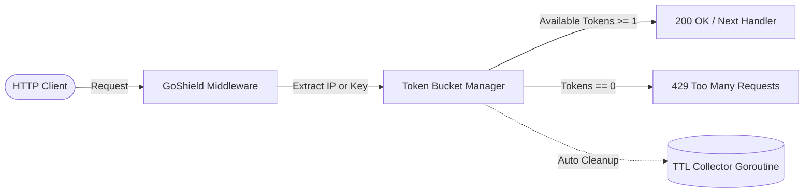

# 🛡️ GoShield — High-Throughput Rate Limiting Engine

[](https://goshield-rate-limiter.onrender.com/health)
[](https://github.com/JohnAlva/goshield-rate-limiter/actions)
[](#)
[](#)
[](LICENSE)

A resilient, low-latency API rate limiting middleware and gateway engine engineered in **Go (Golang)**. Built using a concurrent **Token Bucket algorithm** to defend backend APIs against denial-of-service (DDoS) bursts, scrapers, and abuse while sustaining sub-millisecond response times.

---

## ⚡ Architecture & Concurrency Model

GoShield uses an in-memory, thread-safe token bucket manager protected by fine-grained `sync.RWMutex` locks and atomic counters. Idle clients are automatically recycled by an internal cleanup worker goroutine to prevent memory leaks.



---

## 🚀 Key Features

* **🏎️ Sub-millisecond Execution:** Evaluates limits in $<15\mu s$ with minimal memory overhead.
* **🔒 Thread-Safe & Race-Condition Free:** Validated with the Go race detector (`-race`).
* **👥 Multi-Tenant Identifiers:** Supports rate limiting by Client IP (`RemoteAddr`, `X-Forwarded-For`) or API Key (`X-API-Key`).
* **📊 Standard Headers:** Includes `X-RateLimit-Limit`, `X-RateLimit-Remaining`, and `Retry-After`.
* **🧹 Automatic Garbage Collection:** Periodic background goroutine removes inactive buckets without latency spikes.
* **🐳 Ultra-Light Container:** Final production Docker image weighs **$<15	ext{ MB}$**.

---

## 📦 Quick Start with Docker

Run the gateway locally in one command:

```bash
docker compose up -d
```

Verify health status:
```bash
curl http://localhost:8080/health
```

---

## 🧪 Testing Rate Limits

Send bursts of requests to observe the limiter in action:

```bash
# First 10 requests succeed (burst capacity)
for i in {1..12}; do curl -i http://localhost:8080/api/v1/ping; echo ""; done
```

When the limit is reached, GoShield responds with:

```http
HTTP/1.1 429 Too Many Requests
Content-Type: application/json
Retry-After: 1
X-RateLimit-Limit: 10
X-RateLimit-Remaining: 0

{
  "client": "ip:127.0.0.1",
  "error": "Too Many Requests",
  "message": "Rate limit exceeded. Please back off before retrying.",
  "status_code": 429
}
```

---

## 📈 Inspecting Live Metrics

```bash
curl http://localhost:8080/api/v1/stats
```

Response:
```json
{
  "total_allowed": 1420,
  "total_blocked": 84,
  "active_keys": 12
}
```

---

## 🧪 Running Automated Tests

```bash
go test -v -race ./...
```

---

## 👨‍💻 Author

**Juan Pablo Alvarez Hernandez**  
*Fullstack Developer | Backend Specialist*  
* GitHub: [@JohnAlva](https://github.com/JohnAlva)  
* LinkedIn: [alvcode](https://www.linkedin.com/in/alvcode)

